  

I like building at both ends of the stack: Linux kernel modules and parsers in C/C++ on one side, full-stack web apps on the other. Whatever the layer, I measure before I build and test what I ship.

**Right now:** senior in Honors CS at ASU, Scrum master on my capstone (*My Hockey Pro*, for an external sponsor), and looking for **new grad software engineering roles** starting after I graduate in May 2027.

[LinkedIn](https://linkedin.com/in/bezalelchris) &nbsp;/&nbsp; [Show Radar](https://github.com/bezalelchris/Show-Radar) &nbsp;/&nbsp; [All repos](https://github.com/bezalelchris?tab=repositories)

 

## Things I've built

<table>
  <tr>
    <td width="50%" valign="top">
      
      <h3>Show Radar</h3>
      Concert alerts for artists you follow. Cleans messy Ticketmaster listings and merges duplicates: <b>600 listings → 544 shows</b>, perfect precision and recall on a hand-labeled eval set, enforced in CI.
        
      Python · FastAPI · SQLite · pytest · GitHub Actions
    </td>
    <td width="50%" valign="top">
      
      <h3>Sorting Visualizer</h3>
      Four sorting algorithms, step by step, with live comparison and swap counts. At n = 120, insertion sort takes thousands of comparisons; merge sort takes about 700.
        
      JavaScript · HTML · CSS · <a href="https://github.com/bezalelchris/Data-Structure-Visualizer">code</a>
    </td>
  </tr>
  <tr>
    <td width="50%" valign="top">
      
      <h3>Expense Tracker</h3>
      Balance at a glance and a spending-by-category breakdown. XSS-safe rendering and a migration that keeps old saved data working.
        
      JavaScript · localStorage · <a href="https://github.com/bezalelchris/Expense-tracker">code</a>
    </td>
    <td width="50%" valign="top">
      
      <h3>Pomodoro Timer</h3>
      Focus and break cycles with a progress ring. Timestamp-based countdown that doesn't drift in background tabs, plus a Web Audio chime.
        
      JavaScript · Web Audio API · <a href="https://github.com/bezalelchris/Pomodoro-Timer">code</a>
    </td>
  </tr>
</table>

Also built: an **NLP sentiment analyzer** web app (Python, Flask, Streamlit, scikit-learn) at 90%+ accuracy, deployed on Render.

## Under the hood

Coursework I'm proudest of, all in C and C++:

- **USB block device driver** as a Linux kernel module: reads and writes through the BIO layer via `ioctl`, in 512-byte chunks.
- **Process memory allocator** kernel module exposed through a virtual device, with page-table walking and errno-specific failures.
- **Recursive-descent compiler front end** that generates an intermediate representation for a small language (130/130).
- **Table-driven LL(1) parser** computing FIRST, FOLLOW and predict sets and reconstructing leftmost derivations.

## Experience

<table>
  <tr>
    <td width="36%" valign="top"><b>Engineering Intern</b> Innavion Technologies May – Jul 2026</td>
    <td valign="top">Built UI on an Angular 19 + PrimeNG front end over a Java, MongoDB, Elasticsearch and AWS stack.</td>
  </tr>
  <tr>
    <td valign="top"><b>Robotic & Software Engineering Intern</b> Indo MIM, San Antonio Apr – Jun 2024</td>
    <td valign="top">Programmed Fanuc pick-and-place automation: <b>+20% productivity</b> in secondary operations, and one operator now runs two machines.</td>
  </tr>
  <tr>
    <td valign="top"><b>Scrum Master</b> <i>My Hockey Pro</i> capstone, ASU 2026 – present</td>
    <td valign="top">Run sprints and the Taiga board for a five-person team building a digital trading-card creator for an external sponsor.</td>
  </tr>
</table>

## Toolbox

  

 

Based in Chandler, Arizona. Happy to talk new grad roles, systems, or music. <a href="https://linkedin.com/in/bezalelchris">Say hi on LinkedIn.</a>

